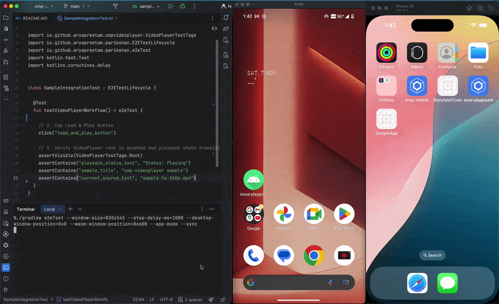

<h1 align="center">CMP Video Player - Compose Multiplatform Video Player Library</h1>

<p align="center">
  
  
</p>

<p align="center">
  <a href="https://github.com/aryapreetam/cmp-videoplayer/actions/workflows/release.yml">
    
  </a>
  <a href="https://mvnrepository.com/artifact/io.github.aryapreetam/cmp-videoplayer">
    
  </a>
  <a href="https://github.com/aryapreetam/cmp-videoplayer/blob/main/LICENSE">
    
  </a>
</p>

<p align="center">
  
  
  
  
</p>

`cmp-videoplayer` is an OSS **Compose Multiplatform** video player component that focuses on one responsibility: **playing video files** across targets.



Supported targets:
- Android (Media3 ExoPlayer)
- iOS (AVPlayer)
- Desktop/JVM (mediamp + VLC)
- Web (wasmJs; HTML5 `<video>`)

Non-goals:
- Embedded providers (YouTube/Vimeo/iframes)
- Poster/image loading (use the `placeholder` slot)

Wasm Demo: 
[](https://aryapreetam.github.io/cmp-videoplayer/demo/)

API Docs:
[](https://aryapreetam.github.io/cmp-videoplayer/api/)

---

## Quick start

### Dependency

Add the dependency to your `commonMain`:

```kotlin
kotlin {
  sourceSets {
    commonMain.dependencies {
      implementation("io.github.aryapreetam:cmp-videoplayer:0.0.3")
    }
  }
}
```

### Basic usage

```kotlin
@Composable
fun MyScreen() {
  VideoPlayer(
    source = VideoSource.Url("https://example.com/video.mp4"),
    config = VideoPlayerConfig(
      autoplay = false,
      showControls = true,
    )
  )
}
```

### Sources
- `VideoSource.Url(url)` supports `http(s)://`, `file://`, and on Android also `content://` and `android.resource://`.
- `VideoSource.Path(path)` is a raw filesystem path (Android/iOS/JVM). On wasm, use `Url`.

---

---

## wasm: playing `Res.raw.*` videos

On `wasmJs`, the HTML `<video>` element needs a URL. If your video is only available via Compose resources (`Res.raw.*`), use `rememberBlobVideoUrl`:

```kotlin
@Composable
fun ResourceVideo(bytes: ByteArray) {
  // `mimeType` is explicit by design.
  val url = rememberBlobVideoUrl(bytes, mimeType = "video/mp4")
  VideoPlayer(VideoSource.Url(url))
}
```

Notes:
- `blob:` URLs are revoked on disposal.
- For large videos, serving them as a static file URL is more memory-efficient.

---

## Testing guidance (important)

The library uses platform interop for real playback. For UI tests, you can force a pure-Compose render path:

```kotlin
CompositionLocalProvider(
  LocalVideoPlayerConfig provides VideoPlayerConfig(renderMode = RenderMode.PlaceholderOnly)
) {
  VideoPlayer(
    source = VideoSource.Url("https://example.com/video.mp4"),
    placeholder = { /* render your test-friendly placeholder UI */ }
  )
}
```

The root node uses the test tag `cmp-videoplayer:VideoPlayer`.

If using snapshots from Maven Local, ensure:

```kotlin
repositories {
  mavenLocal()
  mavenCentral()
}
```

---

## 📦 Download Sample App Executables

Download and try the sample app on your platform without building from source:

| Platform | Download Link |
|----------|--------------|
| 🍏 **macOS (Intel)** | [](https://github.com/aryapreetam/cmp-videoplayer/releases/latest/download/sample-app-desktop-x64.dmg) |
| 🍎 **macOS (Apple Silicon)** | [](https://github.com/aryapreetam/cmp-videoplayer/releases/latest/download/sample-app-desktop-arm64.dmg) |
| 🪟 **Windows** | [](https://github.com/aryapreetam/cmp-videoplayer/releases/latest/download/sample-app-windows.msi) |
| 🐧 **Linux** | [](https://github.com/aryapreetam/cmp-videoplayer/releases/latest/download/sample-app-linux.deb) |
| 🤖 **Android** | [](https://github.com/aryapreetam/cmp-videoplayer/releases/latest/download/sample-app-android-unsigned.apk) |
| 🌐 **Web (Wasm)** | [](https://github.com/aryapreetam/cmp-videoplayer/releases/latest/download/sample-app-wasm.zip) |
|  **iOS Simulator** | [](https://github.com/aryapreetam/cmp-videoplayer/releases/latest/download/sample-app-ios-simulator.zip) |

### 🚀 How to Run the Sample App

For instructions on how to install and run the pre-built executables or build and run the sample application from source code, please refer to the **[How to Run the Sample App](docs/run-sample-app.md)** guide.

---

## License

MIT License © 2025 aryapreetam and contributors. See [LICENSE](./LICENSE) for details.

---

## 🤝 Contributing

See [CONTRIBUTING.md](CONTRIBUTING.md) for detailed contribution guidelines.
